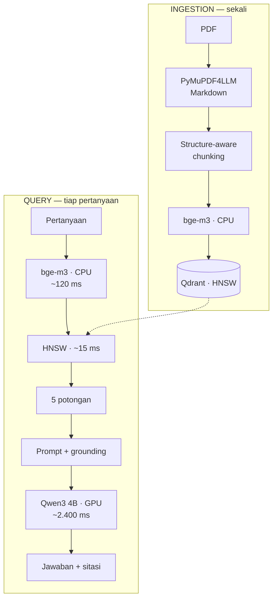

# Tax RAG Indonesia

Sistem tanya-jawab dokumen perpajakan Indonesia yang berjalan **sepenuhnya offline** di laptop dengan GPU 6 GB. Tanpa layanan cloud, tanpa data keluar dari mesin. Tersedia sebagai CLI maupun HTTP API, sehingga bisa dipanggil dari aplikasi lain.

> **English summary** — A fully local RAG system for Indonesian tax regulations, running on a single 6 GB consumer GPU, exposed as both a CLI and an HTTP API. Built with an evaluation-first approach: every retrieval technique was measured against a hand-written golden set before being kept or discarded. Four techniques were tested and rejected based on data, including cross-encoder reranking (211× latency for 2% NDCG gain) and query routing (no measurable improvement).

---

## Hasil

| Metrik | Nilai |
|---|---|
| Recall@5 | 0,800 |
| Recall@10 | 0,920 |
| NDCG@10 | 0,7068 |
| MRR | 0,6390 |
| Akurasi jawaban | 0,640 |
| Refusal rate | 1,000 |
| **Halusinasi** | **0,000** |
| Menolak padahal bisa | 0,120 |
| Latensi retrieval (p95) | 190 ms |
| Latensi total per pertanyaan | 2,7 detik |

Diukur pada golden set 30 pertanyaan yang ditulis manual, konfigurasi `dense` dengan `top_n=5`. Metrik retrieval dihitung dengan [ranx](https://github.com/AmenRa/ranx), termasuk uji signifikansi statistik. Hasil mentah per konfigurasi ada di [`eval/hasil.json`](eval/hasil.json).

**Halusinasi 0,000** artinya: dari 5 pertanyaan yang jawabannya sengaja tidak ada di dokumen, sistem menolak menjawab kelimanya. Di domain regulasi, ini lebih penting daripada akurasi.

Penolakan itu bukan hanya teks jawaban. Ia masuk ke **kontrak API** sebagai field boolean `ditemukan`, sehingga aplikasi pemanggil bisa membedakan "sistem tidak tahu" dari "ini jawabannya" tanpa mencocokkan string.

---

## Yang membedakan proyek ini

Empat teknik diuji lalu **ditolak berdasarkan data**, bukan dipasang karena populer:

| Teknik | Hasil pengukuran | Keputusan |
|---|---|---|
| Cross-encoder reranking | NDCG +2%, latensi **211×** (190 ms → 40.167 ms) | Ditolak |
| Query routing | NDCG turun 0,7068 → 0,6447 | Ditolak |
| Hybrid search (BM25 + RRF) | Recall identik, NDCG lebih rendah (0,6595) | Ditolak |
| Ragas faithfulness | Timeout 100% (25/25 soal) di GPU 6 GB | Ditolak |

Kodenya tetap ada dan dinonaktifkan, lengkap dengan catatan kapan keputusannya harus dibalik — misalnya reranker layak dipakai kalau ada GPU terpisah.

---

## Arsitektur



| Lapisan | Pilihan | Perangkat |
|---|---|---|
| Parsing | PyMuPDF4LLM | CPU |
| Chunking | LangChain MarkdownHeaderTextSplitter + RecursiveCharacterTextSplitter | CPU |
| Embedding | BAAI/bge-m3, 1024 dimensi | CPU |
| Vector DB | Qdrant (HNSW) | Docker |
| Generator | Qwen3 4B Instruct Q4_K_M via Ollama | **GPU** |
| Orkestrasi | LangChain LCEL | — |
| Antarmuka | CLI + FastAPI | CPU |
| Evaluasi | ranx + metrik deterministik | — |
| Observability | Langfuse (self-host, opsional) | Docker |

**Pembagian perangkat disengaja.** VRAM 6 GB hanya cukup untuk satu model. Embedding dijalankan di CPU karena sifatnya batch dan tidak butuh real-time; GPU disediakan penuh untuk model bahasa.

---

## Korpus

- **PMK 168/2023** — Petunjuk Pelaksanaan Pemotongan PPh Pasal 21
- **PP 58/2023** — Tarif Pemotongan PPh Pasal 21 (tabel TER)

88 chunk, rata-rata 325 token, maksimum 538.

PDF asli dari JDIH Kemenkeu ditulis ulang menjadi versi bersih karena PP 58 adalah hasil scan dengan OCR rusak — 102 kemunculan `o/o` yang seharusnya `%`, dan angka `0` terbaca sebagai huruf `O`. PDF asli disimpan di `data/raw_asli/` sebagai arsip.

**Temuan yang memungkinkan pemulihan:** dokumen hukum Indonesia menulis angka dua kali — dalam angka dan dalam huruf di dalam kurung. Versi hurufnya utuh sempurna, karena OCR lebih andal membaca huruf daripada digit. Konversi dari versi huruf bersifat deterministik, tanpa tebakan.

Tabel TER (127 baris tarif) diverifikasi terhadap **8 contoh perhitungan resmi** yang ada di PMK 168. Delapan dari delapan cocok.

---

## Menjalankan

### Prasyarat

- WSL2 Ubuntu atau Linux
- GPU NVIDIA dengan VRAM ≥ 5 GB
- Docker
- [Ollama](https://ollama.com)
- Python 3.10+

### Jalur cepat

```bash
make setup    # sekali saja: venv, model, LLM, .env
make index    # nyalakan Qdrant dan bangun index
make chat     # mulai tanya-jawab di terminal
make api      # atau jalankan sebagai HTTP API di :8000
```

Jalankan `make help` untuk daftar semua perintah. Langkah manualnya dijelaskan di bawah bagi yang ingin memahami tiap tahap.

### Setup

```bash
git clone https://github.com/ell-iothk/tax-rag-indonesia.git
cd tax-rag-indonesia

python3 -m venv .venv
source .venv/bin/activate
pip install -e ".[api]"
```

> `-e` berarti *editable install* — proyek dipasang sebagai tautan, bukan
> salinan, sehingga perubahan kode langsung berlaku tanpa install ulang.
> Ini yang membuat `from taxrag.retrieval import ...` bekerja dari folder
> mana pun, tanpa perlu mengutak-atik `sys.path`.
>
> Tambahan `[api]` memasang FastAPI dan uvicorn. Untuk CLI saja, `pip install -e .`
> sudah cukup. Grup `[dev]` berisi ruff dan pytest.

Siapkan model bahasa:

```bash
ollama pull qwen3:4b-instruct-2507-q4_K_M
ollama create qwen3-id -f Modelfile.qwen3-id
ollama ps        # pastikan "100% GPU" dengan CONTEXT 8192
```

Unduh model embedding dan reranker:

```bash
python scripts/download_models.py
```

Sekitar 4,4 GB ke folder `models/`, sekali saja. Model disimpan sebagai file biasa, bukan cache HuggingFace — struktur cache mudah rusak kalau ada file terhapus manual dan sulit didiagnosis.

Nyalakan database:

```bash
cp .env.example .env
docker compose up -d      # Qdrant saja, secret di .env boleh kosong
```

Opsional, untuk tracing dengan Langfuse (isi dulu secret di `.env`, lihat komentar di dalamnya):

```bash
docker compose --profile observability up -d
```

Bangun index:

```bash
python scripts/ingest.py          # PDF → 88 chunk
python scripts/index_qdrant.py    # chunk → Qdrant (2–5 menit di CPU)
```

### Pakai lewat CLI

```bash
./rag.sh
```

```
tanya> Biaya jabatan maksimal berapa setahun?

Biaya jabatan maksimal sebesar Rp6.000.000 setahun
(potongan [1], PMK 168/2023 Pasal 10 ayat (2)).

  sumber (2.4s): pmk168-2023 Pasal 10 | pmk168-2023 Pasal 11
  /sumber untuk lihat isi lengkapnya
```

Perintah CLI: `/sumber` menampilkan potongan yang dipakai, `/keluar` untuk selesai.

### Pakai lewat API

Dua jalur. **Langsung di host**, memakai venv dan Ollama yang sudah ada:

```bash
make api        # uvicorn di :8000
```

**Atau lewat Docker**, yang membangun image API dan menyambungkannya ke Qdrant:

```bash
make api-up     # docker compose --profile api up -d --build
```

Saat pertama dijalankan, container menyiapkan prasyaratnya sendiri: mengunduh model kalau volume masih kosong, menunggu Qdrant siap, lalu membangun index kalau koleksi `tax_docs` belum ada. Langkah-langkah itu idempoten, sehingga `up` kedua tidak mengulang apa pun. Ollama tetap di host dan dihubungi lewat `host.docker.internal`.

Dokumentasi interaktif tersedia di **`http://localhost:8000/docs`**, dibuat otomatis oleh FastAPI dari skema Pydantic.

#### `POST /v1/tanya`

```bash
curl -s -X POST localhost:8000/v1/tanya \
  -H 'content-type: application/json' \
  -d '{"pertanyaan":"Biaya jabatan maksimal berapa setahun?"}'
```

```json
{
  "jawaban": "Biaya jabatan maksimal sebesar Rp6.000.000 setahun (potongan [1], PMK 168/2023 Pasal 10 ayat (2)).",
  "ditemukan": true,
  "sitasi": [
    { "doc": "pmk168-2023", "pasal": "Pasal 10" },
    { "doc": "pmk168-2023", "pasal": "Pasal 11" }
  ],
  "potongan": [
    { "doc": "pmk168-2023", "pasal": "Pasal 10", "teks": "..." }
  ],
  "latensi_ms": 2714
}
```

`sitasi` dan `potongan` memuat kelima potongan yang dipakai; contoh di atas dipendekkan.

Untuk pertanyaan yang jawabannya tidak ada di korpus, `ditemukan` bernilai `false` dan `sitasi` dikosongkan — menyitir pasal untuk jawaban yang tidak ditemukan justru menyesatkan:

```json
{
  "jawaban": "Tidak ditemukan dalam dokumen.",
  "ditemukan": false,
  "sitasi": [],
  "potongan": [ "..." ],
  "latensi_ms": 1980
}
```

#### `GET /health`

Mengecek Qdrant dan Ollama secara nyata, bukan sekadar membalas `ok`. Mengembalikan `503` kalau salah satu tidak bisa dihubungi, sehingga cocok dipakai sebagai probe.

```json
{ "status": "sehat", "qdrant": "siap", "llm": "siap", "jumlah_titik": 88 }
```

#### Konfigurasi

| Variabel | Default | Keterangan |
|---|---|---|
| `QDRANT_URL` | `http://localhost:6333` | Di dalam compose diisi `http://qdrant:6333` |
| `OLLAMA_BASE_URL` | `http://localhost:11434` | Di dalam compose diisi `http://host.docker.internal:11434` |
| `CORS_ORIGINS` | kosong | Daftar origin dipisah koma. Kosong berarti CORS mati; hanya perlu kalau dipanggil langsung dari browser |

### Evaluasi ulang

```bash
python scripts/evaluate.py              # metrik retrieval
python scripts/evaluate.py hybrid       # bandingkan konfigurasi lain
python scripts/evaluate_jawaban.py      # metrik kualitas jawaban
python scripts/ukur_latensi.py          # p50 dan p95
```

---

## Metodologi evaluasi

### Golden set ditulis manual

30 pertanyaan, dengan komposisi yang dirancang untuk menguji komponen berbeda:

| Kategori | n | Menguji |
|---|---|---|
| `single_hop` | 15 | Retrieval dasar |
| `multi_hop` | 7 | Penggabungan beberapa sumber — di sini chunking ketahuan |
| `unanswerable` | 5 | Keberanian menolak — pengukur halusinasi |
| `lexical` | 3 | Kecocokan kata harfiah (nomor pasal) |

Pertanyaan **tidak digenerate LLM**. Kalau pertanyaan dibuat dari potongan yang sudah ada di index, evaluasinya menjadi sirkular dan skornya tinggi secara palsu.

Field `source_section` memungkinkan **pengukuran retrieval terpisah dari generation**. Kalau jawaban salah, bisa ditentukan apakah penyebabnya pengambilan yang keliru atau penyimpulan yang keliru.

### Kenapa tidak memakai Ragas untuk retrieval

Ragas memerlukan LLM sebagai penilai, sedangkan `source_section` adalah ground truth pasti. Penilaian deterministik lebih cepat, konsisten antar-jalan, dan bebas dari bias LLM-as-judge (*position bias*, *verbosity bias*, *self-preference*).

Ragas tetap dicoba untuk mengukur *faithfulness*, dan gagal karena timeout — lihat bagian batasan.

---

## Beberapa temuan

### Menambah konteks bisa menurunkan kualitas jawaban

Diuji tiga kali per konfigurasi, semuanya reproducible:

| `top_n` | q010 "siapa tenaga ahli?" | Halusinasi |
|---|---|---|
| 3 | benar 3/3 | 0/5 |
| 4 | benar 3/3 | **1/5** |
| 5 | **salah 3/3** | 0/5 |

Potongan ke-5 tidak relevan dan membelokkan model dari jawaban yang ada di potongan ke-1. Dipilih `top_n=5` karena halusinasi lebih berbahaya daripada satu soal akurasi di domain regulasi.

### Metrik retrieval hanya proksi

Dense, hybrid, dan routed menghasilkan Recall@5 yang **identik** (0,800). Yang membedakan hanya peringkat di dalamnya: dense unggul di NDCG (0,7068 versus 0,6595) dan MRR. Namun kualitas jawaban akhirnya sama persis dengan hybrid — 0,640 pada tiga jalan masing-masing.

Artinya keputusan retrieval harus diverifikasi terhadap keluaran akhir, bukan berhenti di metrik perantara. Dense tetap dipilih karena peringkatnya lebih baik tanpa biaya tambahan, bukan karena jawabannya lebih baik.

### Skor embedding tidak boleh dipakai sebagai ambang mutlak

Jawaban benar untuk soal q002 mendapat skor cosine 0,4042; query yang sama sekali tidak relevan mendapat 0,3578. Selisihnya 0,05. Model multilingual memberi skor dasar tinggi untuk teks berbahasa Indonesia apa pun.

### Prompt engineering punya efek samping

Instruksi "baca semua potongan" berhasil menghilangkan halusinasi dari 0,200 menjadi 0,000, tetapi menyebabkan regresi pada satu soal lain. Setiap perubahan prompt diukur terhadap seluruh golden set, bukan satu-dua contoh.

---

## Batasan

| Batasan | Penjelasan |
|---|---|
| **Golden set 25 soal terjawab** | Terlalu kecil untuk uji signifikansi yang kuat. Selisih 2 soal adalah noise |
| **API satu permintaan sekaligus** | VRAM 6 GB hanya cukup untuk satu inferensi LLM, jadi uvicorn dijalankan dengan `--workers 1`. Menambah worker bukan mempercepat melainkan memperebutkan GPU |
| **Reranker tidak dipakai** | Batasan VRAM, bukan batasan teknik. Dengan GPU terpisah, Recall@5 naik ke 0,840 |
| **Ragas faithfulness gagal** | Butuh 3–5 panggilan LLM berurutan per soal; timeout 180 detik terlampaui di 100% soal |
| **Kategori lexical 0/3** | Query yang menyebut nomor pasal harfiah masih gagal. Kata umum seperti "PP", "58", "Tahun" muncul di hampir semua potongan sehingga BM25 kehilangan sinyal pembeda |
| **Model 4B** | Salah memilih item dari daftar bertingkat (q010). Terverifikasi bukan masalah retrieval — jawabannya ada di potongan pertama |
| **PDF ditulis ulang** | Bukan salinan resmi. Untuk keperluan nyata, rujuk PDF asli di `data/raw_asli/` |
| **Tanpa autentikasi** | API dirancang untuk dijalankan di jaringan sendiri. Kalau diekspos ke publik, taruh di belakang reverse proxy dengan autentikasi dan rate limit |

---

## Struktur

```
.
├── pyproject.toml        metadata + dependensi (PEP 621), grup [dev] dan [api]
├── Makefile              setup, layanan, evaluasi, lint
├── src/
│   └── taxrag/           package inti, di-import
│       ├── models.py     pemuat model dengan cache, tracer opsional
│       ├── chunking.py   pipeline chunking + teknik lain (dikomentari)
│       ├── retrieval.py  dense/sparse/hybrid/rerank/routed
│       └── rag.py        LCEL chain
├── api/
│   └── main.py           FastAPI: /v1/tanya, /health
├── scripts/              entry point, dijalankan langsung
│   ├── ingest.py         PDF → chunk
│   ├── index_qdrant.py   chunk → Qdrant
│   ├── download_models.py
│   ├── tanya.py          CLI interaktif
│   ├── mulai_api.py      entrypoint container: siapkan prasyarat lalu uvicorn
│   ├── evaluate*.py      evaluator
│   └── _arsip/           skrip diagnosis dan pendekatan yang ditinggalkan
├── data/
│   ├── raw/              PDF bersih, input pipeline
│   ├── raw_asli/         PDF asli dari JDIH (tidak masuk git)
│   └── processed/        chunks.jsonl (dihasilkan, tidak masuk git)
├── eval/
│   ├── golden_set.jsonl  30 soal, ditulis manual
│   ├── hasil.json        metrik retrieval per konfigurasi
│   └── hasil_jawaban.json
├── Dockerfile            image API
├── docker-compose.yml    qdrant (default), api, observability (profile)
├── Modelfile.qwen3-id
├── rag.sh                startup satu perintah untuk CLI
└── LICENSE
```

Pemisahan `src/` dan `scripts/` mengikuti **src-layout** yang direkomendasikan PyPA: `src/taxrag/` berisi kode yang di-*import*, `scripts/` berisi kode yang di-*jalankan*. Karena akar repo tidak berisi package apa pun, satu-satunya cara import bekerja adalah benar-benar meng-install — sehingga kesalahan setup ketahuan di mesin sendiri, bukan di mesin orang lain.

Teknik yang belum diuji ditulis sebagai kerangka berkomentar di `src/taxrag/chunking.py` dan `src/taxrag/retrieval.py`, lengkap dengan penjelasan cara kerja: parent-child chunking, semantic chunking, late chunking, MMR, metadata pre-filter, HyDE, multi-query.

---

## Lisensi

MIT, lihat [LICENSE](LICENSE).